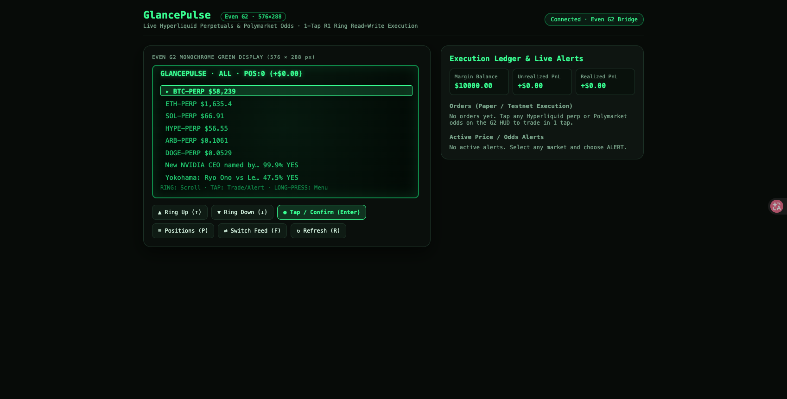
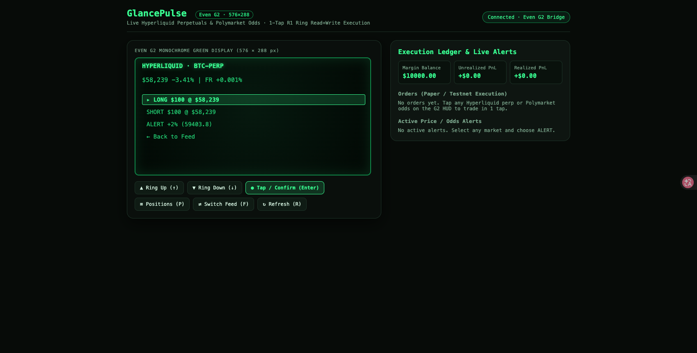
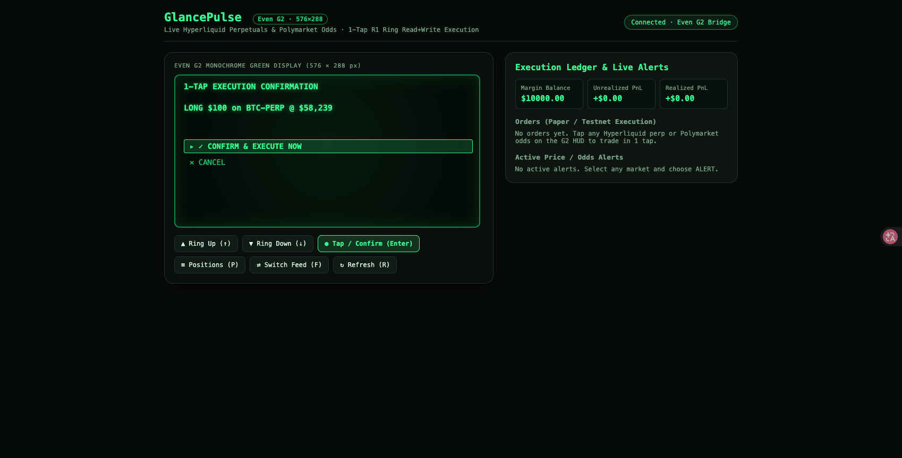
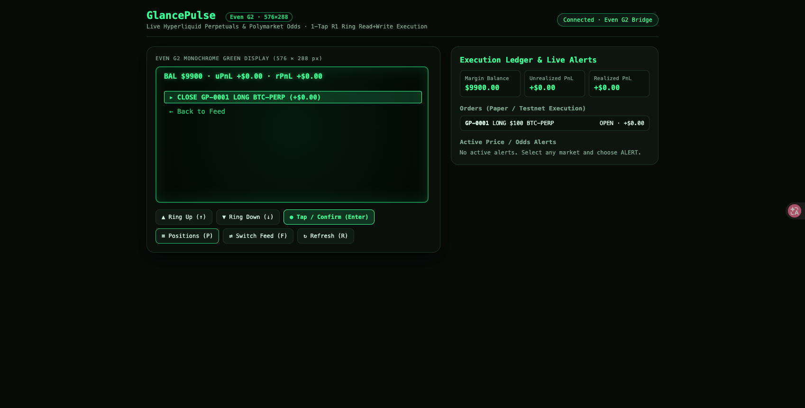

# GlancePulse — Even G2 Live Crypto & Prediction Market HUD

> **Heads Up: Even Realities Hackathon — Track 02 (Crypto & DeFi)**
> Glance at live **Hyperliquid** perpetuals & **Polymarket** prediction odds on **Even G2** (576×288 monochrome green), then act in seconds with **1-tap R1 Ring confirmation**.

---

## Why GlancePulse?

Active crypto & prediction-market traders constantly pull out their phones just to check BTC/ETH/SOL perps, funding rates, or live Polymarket odds — and miss fast moves. **GlancePulse** turns Even G2 into a zero-clutter **Read + Write** heads-up trading companion:

- **Read at a glance (576×288 Monochrome Green)**: High-contrast `textColor` hierarchy (`4` bright headline, `3` live prices/odds, `2` subtle ring hints), max 1 decision per screen.
- **Write in 2 taps (Anti-Misclick R1 Ring Flow)**:
  1. Scroll live **Hyperliquid** perps (`BTC`, `ETH`, `SOL`, `HYPE`, `ARB`, `DOGE`) & top-volume **Polymarket** markets with the R1 Ring.
  2. Tap once to open the focused **Action Card** (`LONG $100`, `SHORT $100`, `BUY YES $25`, `BUY NO $25`, or `SET +2% / +5% ALERT`).
  3. Confirm on the **1-Tap Confirmation Screen** to execute immediately against live market prices, track live unrealized PnL, and 1-tap close from the **Positions** menu.
- **Backend Proxy Architecture**: All external Hyperliquid (`api.hyperliquid.xyz`) and Polymarket (`gamma-api.polymarket.com`) calls + optional Telegram execution receipts run through the local Node backend (`server/index.ts`), keeping keys off the glasses and respecting `app.json` network whitelisting.
- **Native Even Hub SDK v0.0.16 + `.ehpk` Package**: Uses `waitForEvenAppBridge()`, `createStartUpPageContainer`, `rebuildPageContainer`, `ListContainerProperty`, `TextContainerProperty`, `MenuContainerProperty`, and `onEvenHubEvent`, with an automatic 576×288 browser preview mode for instant testing.

---

## Demo Video & Live Screenshots

- **Demo Video (55s, 1280×720 H.264)**: [`docs/glancepulse_demo.mp4`](docs/glancepulse_demo.mp4)
- **Official `.ehpk` Build (SDK 0.0.16)**: [`glancepulse.ehpk`](glancepulse.ehpk)

| Glance Feed (576×288 HUD) | Action Card (Read+Write) | 1-Tap Confirm | Positions & Live PnL |
| --- | --- | --- | --- |
|  |  |  |  |

---

## Quick Start

```bash
npm install

# Terminal 1: Start live Hyperliquid + Polymarket backend proxy (port 8787)
npm run server

# Terminal 2: Start Even G2 WebView frontend (port 5173)
npm run dev

# Run unit & Even G2 layout compliance tests
npm test

# Build & package official .ehpk archive for Even Hub / G2
npm run build
npm run pack:ehpk
```

### Run inside Even Hub Simulator

```bash
npx @evenrealities/evenhub-simulator http://127.0.0.1:5173
```

---

## Optional Telegram Execution Receipts

Set `TELEGRAM_BOT_TOKEN` and `TELEGRAM_CHAT_ID` on the backend server (never in the WebView bundle) to receive instant Telegram notifications whenever you execute or close a trade from your Even G2 glasses.

---

## Built During Hackathon (Nov 23–29, 2026)

100% of GlancePulse was designed, coded, tested, and packaged during the Heads Up hackathon using open-source libraries (`@evenrealities/even_hub_sdk`, `vite`, `typescript`, `vitest`) and public unauthenticated Hyperliquid & Polymarket market data APIs.

## License

MIT License © 2026 Jie Zhou
